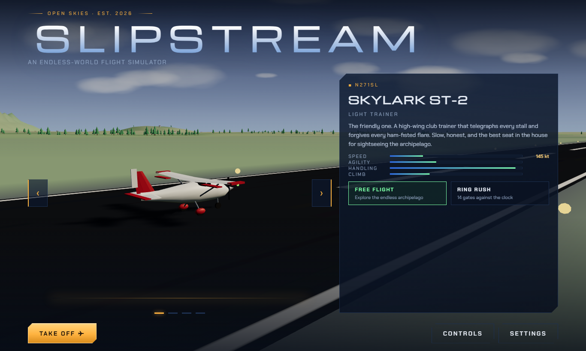
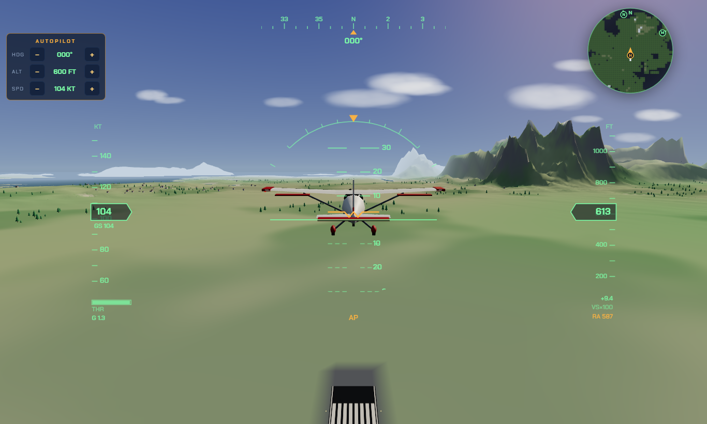

# ✈ SLIPSTREAM

An endless-world flight simulator that runs entirely in the browser — desktop and mobile.
Nine aircraft with genuinely different flight models (including a helicopter, an airliner and the Eurofighter Typhoon), an infinite procedurally generated
archipelago, a glass-cockpit HUD, a time-trial ring course, and a fully procedural
soundscape. No model files, no textures, no audio assets: everything is generated at runtime.




## Quick start

```bash
npm install
npm run dev       # local dev server (LAN-exposed for phone testing)
npm run build     # type-check + production bundle in dist/
npm run preview   # serve the production build
npm test          # headless physics/world test suite (no browser needed)
```

Dependencies are exactly three, pinned: `three`, `vite`, `typescript` (+ `@types/three`).

## Worlds

Three procedurally generated maps, selectable from the hangar (each one endless and
deterministic, all sharing the home airfield cluster):

| World | Character |
| --- | --- |
| **Emerald Archipelago** | Island chains, forests and farmland, hill country, rivers winding to the sea, snow-capped alpine ranges and the odd volcano standing out of the water. |
| **Redstone Mesa** | Layered desert plateaus carved by winding canyon systems, free-standing mesas and buttes, dune seas. |
| **Meridian Bay** | A coastal metropolis: two downtown cores with 400 m+ setback supertalls, glass and concrete towers, street grids, parks and suburbs. |

### Time of day

Every world flies under four selectable skies — **Dawn Patrol**, **High Noon**,
**Golden Hour** and **Full Moon** — picked from the hangar (or `?tod=dawn|day|dusk|night`).
The dark presets light the world up: a procedural star field and moon, glowing
city windows and blinking red obstruction beacons on the supertalls (Meridian Bay
at night is worth the trip), runway edge lights, and aircraft anti-collision
beacon/strobes plus a working landing light that pools on the tarmac in the flare.
Every runway also carries **PAPI** approach lights — four boxes beside the southern
threshold showing real red/white glideslope indication ("two white two red,
you're all right") computed live from your approach angle, day or night.
Airfield lights behave like real point sources: edge lights and PAPI hold a
couple of pixels at any range instead of vanishing, and after dark every field
runs a rotating **white/green airport beacon** you can spot from 15+ km — that's
how you find a runway at night.

### Weather

Six skies from the hangar (or `?wx=clear|fair|broken|overcast|rain|fog`): **Clear**,
**Fair** (scattered cumulus), **Broken** (a layer at 4,300 ft with gaps to fly through),
**Overcast** (solid from 2,100 ft, sunshine on top at 5,000), **Rain** (cloudbase 1,000 ft,
4 km in rain, gusty) and **Fog** (700 m at the surface, blue sky above 600 ft). The cloud
is a real layer with a shape — an undulating top with cumulus standing out of it, a ragged
base, wispy edges — drawn by marching each pixel's view ray through the same volume the
aircraft flies through: beneath it the light is grey and you see what the weather allows,
inside it you see a few hundred metres, skimming the tops you are in and out of them, and
above it the sun is out over an undercast. Wind and
turbulence follow the weather, the tower reads you the sky with your clearance, and the
ILS finally has a job — in Rain the runway appears at about 1,000 ft, in Fog at the flare.

### ILS

Every runway carries a full **instrument landing system** with real approach
geometry: a localizer measured from an antenna past the stop end (±2.5° full
scale), a 3.00° glideslope from a station 300 m in from the threshold
(±0.7° full scale, ~18 m threshold crossing height), and DME. The receiver
auto-tunes the best runway end ahead of the nose — internationals serve all
four parallel approaches (27L/27R style) — announces the capture with a
toast, then **holds the station like a real tuned nav radio** until you fly
out of range or line up on a different runway (needles peg off-beam instead
of the display popping in and out; `I` switches the receiver off/auto). The
HUD shows classic deviation scales: fly toward the diamonds; they turn
green when you're captured. Pair it with the PAPI lights and you can shoot a stabilised
approach in any aircraft, day or night.

### Wind

Free flight rolls a light breeze each takeoff (3–15 kt from a random heading —
the tower calls it on the clearance, the HUD shows it under groundspeed, and
every windsock points with it). All aerodynamics run on air-relative velocity,
so crosswind drift, crab angles, IAS/GS splits, into-wind hovering and
wind-aware autorotations all just emerge. Races and smoke tests stay calm so
times are comparable; `?wind=hdg,kt` forces a specific wind.

## Flying

| Control | Keys |
| --- | --- |
| Pitch / Roll | `W S` / `A D` (or arrows) |
| Rudder | `Q` / `E` |
| Throttle | `Shift` / `Ctrl`, presets `1–9`, `0` = idle |
| Flaps / Gear | `F` & `V` / `G` |
| Wheel brakes / **fire cannon** (airborne, Vector & Typhoon) | `Space` (hold) |
| Speed brake (jets) | `B` |
| Autopilot (alt + hdg + speed hold) | `T` — any stick input disengages |
| Autopilot bugs | on-screen panel, or `[` `]` heading · `PgUp` `PgDn` altitude · `Home` `End` speed · `;` `'` vertical speed |
| Camera (chase / cockpit / orbit) | `C` |
| Look around / zoom | mouse drag / wheel (recentres on release) |
| HUD full / minimal / off | `H` |
| Minimap on/off | `M` |
| Nav chart / flight computer | `N` (zoom `,` `.`) |
| ILS receiver auto / off | `I` |
| Autopilot **approach** — ILS-coupled autoland | `L` (or APPR on the autopilot panel) |
| Practice **engine failure** | `X` — singles: engine out / relight. Twins: No.1 out, both out, relight |
| Pause | `Esc` or `P` |
| Restart flight | `R` |

On touch devices: left virtual stick (pitch/roll), right throttle lever (stays where you
set it), rudder pedals bottom-centre, hold-to-brake, and a top row of buttons — gear,
flaps (cycles 0-1-2-3-2-1-0, so one tap takes a stop back out), camera, autopilot,
speed brake and **NAV**, which opens the flight computer chart. Pause is the ⏸ button
top-right. Sound plays through the media channel as a *mixing* audio session
('transient'), so the iPhone mute switch doesn't silence it and your background
music keeps playing alongside it.

**Takeoff:** full throttle, one notch of flaps, rotate gently past the middle of the
speed tape. If `STALL` flashes — nose down, power up.

### The fleet

| Aircraft | Character |
| --- | --- |
| **Skylark ST-2** | Forgiving high-wing trainer. Slow, stable, lands anywhere. |
| **Islander BN2T** | Turbine utility twin, tuned to the real BN2T's book numbers: ~330 m ground roll, ~1,000 fpm climb, ~170 kt max cruise, 45–52 kt stalls. |
| **Bell 505 Jet Ranger X** | Light helicopter with its own flight-model regime: throttle is the collective, cyclic is attitude-command, pedals turn the hover. Translational lift, ground effect, torque, flapback (the nose rises with speed — cruise takes standing forward cyclic), tail-rotor drift in the hover, and vortex ring state if you sink onto your own downwash. Press `X` for a practice **engine failure**: rotor RPM becomes real energy — collective down at once or NR droops and the low-RPM horn sounds; keep speed on and it **autorotates** (~1,700 fpm, 3:1 glide), flare and spend the rotor's last energy on the cushion — with the engine out the skids and seats soak up arrivals to a ~30 kt impact, so a firm auto is a story, not a crash screen. The SAS envelope is no cage either: hold the cyclic on the stop and she'll roll right through — possible, inadvisable, occasionally fatal. Heli HUD shows TRQ and NR; `T` in a hover gives a hover hold. Skid landings anywhere flat. |
| **Falcon Mk.IV** | WWII warbird. Huge roll rate, bites in the stall, tail-dragger. |
| **Vector V-25** | Delta-wing fighter. Afterburner at 100% throttle, 900+ kt, internal cannon — pop the target balloons east of Meridian Intl. |
| **Eurofighter Typhoon** | The real thing, to the book: 51.2 m² canard delta, twin EJ200s (60/90 kN), reheat T/W above 1, ~380 m ground roll, 1,100+ kt dash, and a 9 g **carefree envelope** — the FBW alpha/G limiters mean you can haul the stick to the stop and she takes what the airframe is rated for, no more. Cannon fitted. |
| **Meridian 700** | 16-tonne executive jet. Stately, fast in cruise, needs planning. |
| **Airbus A320neo** | 64-tonne narrowbody airliner in flag-carrier colours, built to the real book numbers: 122.6 m² wing, twin LEAP-class engines, rotate ~150 kt, full-flap stall ~110 kt, MMO ≈ 470 kt, +2.5 g transport limits and normal-law **alpha protection** (full aft stick mushes — it will not stall). Fly the profile and grease it on. |

**Engine failures:** `X` fails an engine in any of them. A single becomes a glider (the
HUD gives the best-glide speed for your height — 9:1 in the trainer, 14:1 in the A320);
a twin loses its left engine first, swings toward it and needs rudder to fly straight —
the Islander will just about climb on one — and a second press takes the other.

Each one is parameterised physically (mass, wing area, lift slope, stall angle, drag,
thrust model) — the handling differences fall out of the numbers, not scripts.

### Modes

- **Charter** — paying work. Take-off opens the **job board** of the field you are at:
  passengers, freight, a medevac, a priority dispatch, each to an airfield your aircraft
  can actually use (airliners fly between internationals, the trainer to grass strips).
  The destination goes into the flight plan and is ringed on the map. You are paid when
  you are down and stopped there: the fee, adjusted for punctuality (+15% early … −40%
  late), the landing grade and — with people aboard — the ride (they mind g, steep banks
  and a hard arrival). The destination becomes your base, with a fresh board.
- **Free Flight** — explore. The world streams in around you forever: coasts, forests,
  settlements, snow-capped ranges. Three **international airports** anchor the map at
  a European ~100 km spacing — **Meridian Intl** (spawn), **Westgate Intl** and
  **Osprey Intl** — each built like Heathrow: twin parallel runways (3.5–3.9 km,
  1.4 km apart, 27L/27R-style designators painted on; land on whichever you line up —
  the ILS tunes per runway), parallel taxiways with connectors, a central terminal
  spine with pier fingers (solid — don't fly into them), 24 marked gate stands with
  jet bridges, baggage tugs and fuel bowsers working the aprons, floodlight masts,
  cargo hangars and an 87 m control tower. Around them sit the smaller fields — **Northgate Strip**,
  **Highmoor Field** — and procedural strips every ~25–40 km of land, deterministically
  seeded so they're always in the same place, the longest of them full regional fields
  with hangars and a tower. The minimap marks every runway as an oriented strip (so you
  can line up an approach from miles out), paints the internationals amber with their
  parallel pairs, and always points the way home. Press `N` for the **flight computer**: a
  zoomable, scrollable north-up chart — drag to pan far beyond the streamed horizon
  (it draws from the analytic heightfield, so distant terrain and airfields cost no
  3D rendering), click to drop waypoints (clicks near a runway snap to it),
  read per-leg true headings, distances and ETE, then ENGAGE NAV and the autopilot
  flies the plan, sequencing each fix.
- **Ring Rush** — 14 gates against the clock. Best time per aircraft is saved locally.
- **Final Approach** — you start airborne on final to one of the home runways, a few
  kilometres out, slightly off the centreline and the glide path, with a fresh head- or
  crosswind every time. Land it and stop: the debrief grades the touchdown out of 100 —
  **sink rate** (40), **centreline** (30) and **touchdown zone** (30) — and tells you which
  third to fix. Best score per aircraft is saved.

Every runway landing is graded the same way in Free Flight too (a toast calls the grade,
the touchdown rate in fpm, how far off the line and how far in), and the hangar keeps
your best.

### Autoland

With an ILS tuned, press `L` (or **APPR** on the autopilot panel) and the autopilot
couples to it: it intercepts and tracks the localizer on ground track — so the crab into
a crosswind simply emerges — holds altitude until the glide path comes down to meet it,
rides the 3° path at the reference speed for whatever flap you have set, flares off the
radio altimeter, closes the throttles, and holds the centreline on the rollout with the
autobrake on. **Gear and flaps are yours** — the capture call reminds you — and the
approach speed follows whatever flap you select; touch the stick and the aircraft is yours.
It works in every fixed-wing aircraft, from the Skylark to the A320.

You can arm it from cruise: it slows to an intercept speed (using the speedbrake if it
has to), turns onto the localizer without sailing through it, and only starts down once
it is established. Give it room, though — about 3° of glide path means roughly **300 m
of height per 6 km**, so 15 km out you want to be near 800 m (2,500 ft) above the field,
not 2,000. If the approach cannot end on the runway it says why and **goes around**
instead of pressing on: too high for the glide path, too fast or off the centreline at
300 ft, gear still up, or floating past the middle of the runway.

### Warnings

A master warning watches the flight path: **PULL UP** when it meets terrain (or the sea)
within about eight seconds, **TOO LOW — GEAR** when you are low, slow and descending with
the wheels up, **OVERSPEED** past VNE. The landing gear is real, too: the lever is locked
by a squat switch on the ground, and touching down with it retracted ends the flight.

### Gamepad

Plug in a controller and fly: left stick pitch/roll, right stick rudder, **RT/LT** throttle
(analog — it stays where you leave it), **A** brakes/cannon, **B** speed brake, **Y** gear,
**X** camera, **LB/RB** flaps, D-pad ▲ autopilot, ▼ APPR, ◀ HUD, ▶ nav chart, **Start** pause.
Flight sticks with a non-standard layout get stick + trigger.

The sky, the ramps and the sea are alive. **NPC aircraft** park nose-in on the
international terminal stands and on regional aprons and strip edges (never
blocking a runway — deterministic per field, like everything else), and a
handful of AI airliners and light singles cruise terrain-aware tracks through
your patch of sky with nav lights and strobes blinking — two of them high
overflights drawing **contrails**. The airports **work**: airliners fly the ILS
into the internationals every two or three minutes, land, roll out and vacate,
while others taxi on, line up and depart — always on the into-wind runway, one
movement at a time, landing lights on. They use the eastern runway of each pair
(you spawn on the western one); sit on theirs and arrivals **go around**.
Regional fields see the same with light singles. All of it is **on the map** — aircraft
as cyan arrowheads with their height relative to yours in hundreds of feet, ships as grey
ticks — and the **tower talks**: "cleared to land" with the wind once you are established
on final, "continue approach" if something is still on the runway, "go around" if it has
not cleared by short final, and "traffic, 2 o'clock, 3 km, 500 ft above" when something
gets close. Out at sea, **freighters,
ferries and small boats** trail wakes and steer clear of the shallows. Races
keep the air to themselves.

## Engineering notes

- **Terrain** is an analytic heightfield (domain-warped FBM + ridged multifractal,
  seeded simplex). The render mesh, tree/settlement scattering *and* collision all sample
  the same function, so what you see is exactly what you hit — including the scattered
  solids: towers, houses, trees and mesa hoodoos derive collision volumes from the same
  deterministic placement lists the renderer instances, so you can't fly through a
  skyscraper (cannon rounds stop on them too). Chunk generation runs in a
  **Web Worker** — payloads arrive as transferable typed arrays, so the main thread never
  hitches while streaming chunks around the aircraft.
- **Level of detail is a function of distance, not time.** Chunks come at four nested
  resolutions over two coarse shells of the same heightfield — a far shell out to ~40 km
  and a **horizon shell** out to ~180 km. Every
  chunk carries its *parent* level's look — heights, colours and normals sampled on the
  coarser lattice — and the vertex shader blends parent → own by each vertex's distance,
  inside a per-level band. Mesh swaps (up *and* down a level) are scheduled in the dead
  zones between bands, where the two meshes involved render the identical surface, so a
  swap changes no pixel; trees and buildings ride distance bands the same way. In steady
  flight nothing animates: terrain simply carries more detail the closer it is, and the
  detail horizon travels with you. (Earlier builds animated each change over time —
  however exact the start frame, an arc of tiles sharpening together is an event the eye
  catches. The policy lives in `src/world/lod.ts` with a simulated-flight test that checks
  every swap, arrival and removal is pixel-identical.)
- **You can see a long way.** At ground level the haze closes at 7–16 km (by quality),
  not at the edge of the detailed terrain, and it opens with height to 200 km.
- **The horizon is where a horizon belongs.** Terrain reaches 90–216 km (by quality), and
  the haze opens with altitude so its far edge sits ~3–4° below eye level at airliner
  cruise — about where the real horizon is — instead of the world ending in a hazy disc
  far below you. The far shell blends into the horizon shell by distance exactly as chunks
  blend into it, haze is measured as true distance from the eye, and fully hazed land,
  sea and sky are the same colour, so the edge of the world never shows.
- **Airports have real approach surfaces.** Off every runway end a 2° obstacle-limitation
  plane keeps terrain, trees and city towers out from under the 3° glide path — as at any
  real airport — so every ILS in the procedural world is actually flyable.
- **Flight model**: real force integration — CL(α) curve with post-stall falloff, induced
  drag from aspect ratio, sideslip weathervaning, control authority scaling with dynamic
  pressure, air density falling with altitude, ground roll with brakes/steering and crash
  detection (sink rate, attitude, slope, water). Per-aircraft G-limits cap pitch authority
  at speed, the fighter has a fly-by-wire alpha limiter, and weathervane stability stiffens
  with true airspeed so high-Mach flight stays honest. Engines spool (jets take seconds to
  wind up), ground effect floats the flare, prop torque wants right rudder on takeoff, and
  light low-altitude turbulence keeps cruise alive.
- **Audio** is synthesized WebAudio: prop firing tone, jet spool noise, wind that swells
  with airspeed, stall beeper, touchdown thumps.
- **Quality presets** (low/med/high) scale pixel ratio, shadows, view distance and cloud
  count; the default is picked from device class.

### Dev/test URL parameters

- `?autofly=1` — autopilot takes off and climbs (demo / smoke test; telemetry in the tab title)
- `&ff=60` — fast-forward N seconds of physics before the first frame
- `&ac=vector` — select aircraft (`skylark`, `islander`, `jetranger`, `falcon`, `vector`, `typhoon`, `meridian`, `a320`)
- `&tod=night` — time of day (`dawn`, `day`, `dusk`, `night`)
- `&wind=240,12` — force wind (heading it blows from, knots); free flight is random otherwise
- `&mode=race` — start in Ring Rush
- `&touch=1` — force the touch UI on desktop
- `&apt=1` — spawn at another fixed airfield (1 = Northgate, 2 = Highmoor, 3 = Westgate Intl, 4 = Osprey Intl)
- `&ap=1` — engage the autopilot after the fast-forward
- `&world=mesa` — select the map (`archipelago`, `mesa`, `metro`)
- `&hdg=302` — point the takeoff at a given true heading
- `&nav=1` — open the planning chart after the fast-forward
- `&mode=approach` — start in Final Approach (with `autofly=1` the autopilot flies the ILS to an autoland)
- `&q=low` — graphics quality (`low`, `medium`, `high`)
- `&alt=6000` — jump to that altitude (metres) after the fast-forward
- `&touch=1` — force the touch UI (with `&q=low`, the phone render path)
- `&lodtint=1` — tint terrain by LOD level, darkened by how far each vertex is blended toward its parent (the distance bands show as rings)
- `&lodlog=1` — log any LOD swap that was not between identical surfaces

## Deploying

The site is fully static (`npm run build` → `dist/`) and deploys on Cloudflare Pages
(build command `npm run build`, output `dist`). Two lockfile rules keep `npm ci` green
on Cloudflare's **npm 10.9.2**:

1. **After changing dependencies**, regenerate the lockfile with Cloudflare's npm —
   npm 11 builds a different ideal tree that npm 10 rejects:
   `npx -y npm@10.9.2 install --package-lock-only --ignore-scripts`
2. **Before committing, check `git status package-lock.json`.** A cold-cache `npx` run
   (npm 11) can silently *prune* the top-level `@emnapi/core` / `@emnapi/runtime`
   entries (~26 lines) that npm 10 requires. If the lockfile shrank and you didn't
   change dependencies, restore it: `git checkout HEAD -- package-lock.json`.
   (The test runner calls the local `tsc` directly rather than `npx tsc` for this
   reason.)
